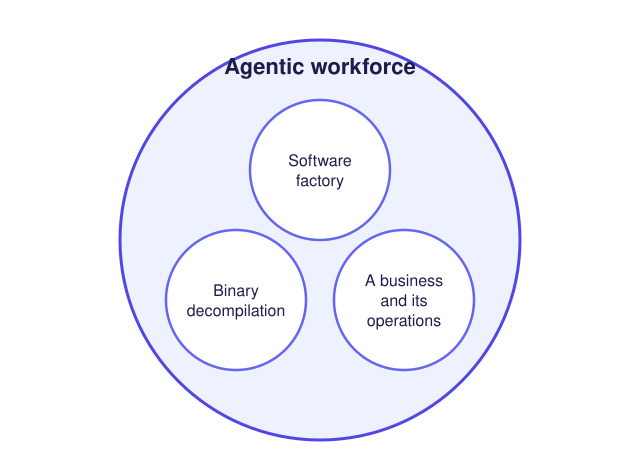

# Jive

Jive is a **developer platform** and an **agentic workforce platform**. Its purpose is to remove every human step from
building and running software and organizations except one: **consent**, a person saying yes to something done on
their behalf. Jive brings the request to the person, takes the yes (a passkey tap), and does everything else.

- **Developer platform:** the `jive` CLI (this repository), the CI/CD pipeline every Jive package runs (its
  [reusable workflow](.github/workflows/reusable-pipeline.yml), contract in [CICD_API.md](CICD_API.md)), and resource
  provisioning, which makes sure every resource a package needs exists in its organization.
- **Agentic workforce platform:** workforces of agents and code that run an organization's work. A software factory
  is one kind of workforce, binary decompilation another, a business and its operations another.

<picture>
  <source media="(prefers-color-scheme: dark)" srcset="docs/jive-platforms-dark.svg">
  
</picture>

## Agentic workflows, not skills

A **skill** is instructions an agent reads: it may follow them, skip a step, or forget them after a long session, and
nothing records whether it did. An **agentic workflow** is a process defined in code: each step is deterministic code
or a call to an agent for one bounded task; triggers (a schedule, a commit, a message, a threshold) start it; its
state is saved at every step, so a failed or interrupted step is retried rather than the whole run; and every step
records its start, end, outcome and cost. What must happen is enforced by the workflow, not hoped for from the agent.

So a business process in Jive is "a running, inspectable, maintainable workflow instead of a fragile chain of manual
procedures" ([architecture §3.3](docs/jive_architecture_discussion.md#33-arbitrary-durable-workflows)), and agents
are called for bounded tasks rather than kept as long-running conversations
([§2.A](docs/jive_architecture_discussion.md#a-workflows-versus-long-lived-claude-channels)). A workforce is a set of
such workflows, the agents they call, and the connectors they act through
([§3.2](docs/jive_architecture_discussion.md#32-agentic-workforces)). *Planned:* agentic workflows as a package kind
(`jive-abstract-resource-agentic-workflow`) and workforces built from them.

## A marketplace of package kinds

Everything in Jive is an npm package, and **every kind of package is itself a package**: an *abstract*,
`jive-abstract-<kind>`, implements the six CI/CD hooks for that kind, owns its manifest schema, and scaffolds new
packages of the kind. Extending one gives a package a working pipeline with no CI configuration of its own. Kinds
built today: `jive-abstract-library` (npm libraries and CLIs, this one included), `jive-abstract-backend-convex`,
`jive-abstract-app-expo`, `jive-abstract-docker-image`, `jive-abstract-backend-spacetimedb`, and
`jive-abstract-abstraction`, which creates new abstracts. Anyone can publish an abstract, so the set of kinds grows
like a marketplace. *Planned:* `jive create <kind>` finds every `jive-abstract-*` package and offers them as a menu
(`jive create agentic workflow` resolves `jive-abstract-agentic-workflow`).

**Resources** are the same idea for what packages use. A resource kind is an abstract defining a contract
(`jive-abstract-resource-connector-package-registry`), and an implementation is a package on one system
(`jive-resource-connector-package-registry-npm`). An organization configures one implementation per kind, and callers
name only the kind: `jive provision connector-package-registry @scope/name` makes sure that package exists on
whichever registry the organization uses. Public *ecosystem* packages (abstracts, connectors) are shared; a *usage*
package is someone's own use of them.

## No monorepo needed

Jive began as a way to make independent repositories work like a monorepo
([§1](docs/jive_architecture_discussion.md#1-executive-framing)). Each package keeps its own repository, version and
pipeline, and Jive supplies what a monorepo would:

- **One checkout for local work:** `jive init` makes any repository a workspace and `jive load` adds repos to it as
  submodules, all signing and pushing the same way, and `jive load` links each one for local development.
- **One way to ship:** every repository runs the same reusable pipeline through its abstract.
- **Connectors instead of shared code:** a package declares the resources it needs and the organization's connectors
  provide them, so nothing has to live in the same repository to work together. *Planned:* the code-repository
  connector (`jive-abstract-resource-connector-code-repository`, GitHub for jive-sh), so a package's repository and
  its URLs come from the organization rather than from paths or a hard-coded host.

## What Jive borrows from Brazil and Version Sets

Amazon builds its services with an internal system called **Brazil**, organised around many small repositories
rather than one. Public descriptions of it are second-hand: a former Amazon build-team engineer's account
([gist, 2017](https://gist.github.com/terabyte/15a2d3d407285b8b5a0a7964dd6283b0)) and
[ByteByteGo's guide](https://bytebytego.com/guides/how-does-amazon-build-system-work/). In them:

- code is broken into **packages**, each team owning its own repositories;
- a **version set** is "a list of package versions that are known to be consistent together", and every build runs
  "in a version set";
- a default version set, **live**, is where anyone publishes, and each team keeps its own version set, so "no one team
  is blocked on" another's builds;
- minor versions are non-breaking, and major versions are "picked up by request only".

Jive takes the same shape: independent packages in independent repositories and, *planned*, **version sets**: a
pinned set of package versions known to work together, built and tested as a whole before it is promoted, with
dependents updated when a dependency publishes and versions derived from API changes
([§15.2](docs/jive_architecture_discussion.md#152-versioning-and-version-sets)). Today each package pins the exact
versions it builds with.

## Install

```sh
bun add -g @jive-sh/jive
```

Installing registers `jive-signing-agent` to start at login (a LaunchAgent on macOS, a `systemctl --user` unit on
Linux, a scheduled task on Windows).

## Commands

| Command | What it does |
| --- | --- |
| `jive login` | Opens `https://jive.sh/login?request=…`, where you sign in with your jive.sh passkey, and waits; then fetches your account's public key, which the server creates on first use. |
| `jive login --cicd` | In a GitHub Actions job with `id-token: write`: exchanges the job's ID token for a session of its pipeline. |
| `jive whoami` | Prints the Jive account (`<handle>@jive.sh`) this machine is signed in as. |
| `jive init` | Makes the git repository you are in a workspace: adds `/.jive/` to its .gitignore, signs in to GitHub (one approval), rewrites every .gitmodules at every depth to https URLs, checks out every submodule not yet checked out (one already checked out keeps its HEAD), and configures the root, every submodule and every untracked repository inside it to sign with your account key and push over SSH through `jive-signing-agent`. |
| `jive load <org> <repo>` | Adds a GitHub repo to the workspace as a submodule by its https URL, fetches its submodules, registers your account key on GitHub as an authentication and signing key, configures it the same way, then runs `bun install` and `bun link`. |
| `jive unload <org> <repo>` | Removes a loaded repo. |
| `jive on <org> <repo> -- <command…>` | Runs a command in a loaded repo's directory; its exit code is jive's. |
| `jive provision <kind> <name>` | Makes sure a resource instance exists, e.g. `jive provision connector-package-registry @scope/name`. The instance is `./package.json`'s `jive.resources.<kind>.<name>`, or `--instance '<json>'`. Needs a pipeline session. |
| `jive daemons` | Lists every Jive daemon registered on this machine, with its state, executable and log. |
| `jive upgrade` | Upgrades jive with the package manager that installed it. |

`--help`, `--version` and Tab completion (`jive --setup-completion`) work as for every command built with
`jive-abstract-library`'s `Cli`.

## How signing works

Your SSH key lives with your Jive account on [`@jive-sh/server`](https://github.com/jive-sh/server); this machine keeps
only its public key (`~/.jive/ssh/account.pub`). A session comes only from your passkey (`jive login`) or, for a
pipeline, its GitHub OIDC token (`jive login --cicd`), and is kept in `~/.jive/session.json` (owner-only, 12 hours).
`jive-signing-agent` serves the SSH agent protocol on `~/.jive/signing-agent.sock`: it lists the public key and sends
each request's bytes to the server's `ssh:sign`, opening the sign-in page itself when no session is live. Each
repository `jive init` or `jive load` configures signs through `jive-ssh-keygen` (ssh-keygen pointed at the agent) and
pushes with `core.sshCommand` through the agent; your `~/.ssh/config` is untouched. Signing needs `ssh-keygen`
(OpenSSH) on PATH.

## Developing

```sh
bun install
bun run jive:cicd:audit   # type check and tests
bun run install:local     # build with the jive-abstract-library checkout beside this one, install globally
```

Tests never reach jive.sh, the server or GitHub. The signing agent's tests run the real `ssh-keygen` and `ssh-add`
against a fake server; `src/workspace-cutover.test.ts` runs `jive init` on a scratch workspace with nested submodules,
signs a commit through the agent and pushes it over SSH to a local sshd.
