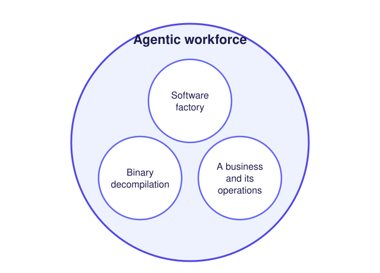

# Jive

Jive is a **developer platform** and an **agentic workforce platform**. It takes the manual steps out of building,
shipping and running software, and the infrastructure behind it. A few ideas run through all of it:

- **Agents in the cloud** (planned). Agentic workflows run on cloud compute with a session Jive gives them, not on a laptop that
  has to stay on.
- **Composable agentic workflows** (planned). A workflow is a package built from steps, and a workforce is built from workflows.
- **Minimal configuration.** A package extends an abstract for its kind and gets its pipeline, its config schema and
  its scaffold from it.
- **Composable software.** Packages declare the resources they need instead of sharing code, so independent
  repositories work together without a monorepo.

- **Developer platform:** the `jive` CLI (this repository), the CI/CD pipeline every Jive package runs (its
  [reusable workflow](.github/workflows/reusable-pipeline.yml), contract in [CICD_API.md](CICD_API.md)), and resource
  provisioning, which makes sure every resource a package needs exists in its organization.
- **Agentic workforce platform:** workforces of agents and code that run an organization's work. A software factory
  is one kind of workforce, binary decompilation another, a business and its operations another.

<picture>
  <source media="(prefers-color-scheme: dark)" srcset="docs/jive-platforms-dark.svg">
  
</picture>

## Agentic workflows, not skills

A **skill** is instructions an agent reads: it may follow them, skip a step, or forget them after a long session, and
nothing records whether it did. An **agentic workflow** is a process defined in code: each step is deterministic code
or a call to an agent for one bounded task; triggers (a schedule, a commit, a message, a threshold) start it; its
state is saved at every step, so a failed or interrupted step is retried rather than the whole run; and every step
records its start, end, outcome and cost. What must happen is enforced by the workflow, not hoped for from the agent.

So a business process in Jive is "a running, inspectable, maintainable workflow instead of a fragile chain of manual
procedures" ([architecture §3.3](docs/jive_architecture_discussion.md#33-arbitrary-durable-workflows)), and agents
are called for bounded tasks rather than kept as long-running conversations
([§2.A](docs/jive_architecture_discussion.md#a-workflows-versus-long-lived-claude-channels)). A workforce is a set of
such workflows, the agents they call, and the connectors they act through
([§3.2](docs/jive_architecture_discussion.md#32-agentic-workforces)). *Planned:* agentic workflows as a package kind
(`jive-abstract-resource-agentic-workflow`) and workforces built from them.

## A marketplace of package kinds

Everything in Jive is an npm package, and **every kind of package is itself a package**: an *abstract*,
`jive-abstract-<kind>`, implements the six CI/CD hooks for that kind, owns its manifest schema, and scaffolds new
packages of the kind. Extending one gives a package a working pipeline with no CI configuration of its own. Kinds
published on npm: `jive-abstract-abstraction` (the abstract every abstract extends), `jive-abstract-library` (npm
libraries and CLIs, this one included), `jive-abstract-backend-convex`, `jive-abstract-app-expo`,
`jive-abstract-app-github-pages`, and the resource kinds below. Anyone can publish an abstract, so the set of kinds
grows like a marketplace. `jive-abstract-docker-image` and `jive-abstract-backend-spacetimedb` are not built yet.

`jive create <kind words…>` makes a new package of a kind from its abstract's template: `jive create library`
resolves `jive-abstract-library`, and `jive create agentic workflow` would resolve `jive-abstract-agentic-workflow`.
Each abstract keeps a real, working sample package of its kind at `src/template/`, and its build, which comes from
`jive-abstract-abstraction`, turns that sample into the `.ejs` template it publishes, replacing the literals its
`jive.abstract.replacements` names with the inputs `jive create` asks for. Today only `jive-abstract-library` and
`jive-abstract-abstraction` have templates. *Planned:* `jive create` lists every `jive-abstract-*` package as a
menu, with Tab completion.

**Resources** are the same idea for what packages use. A resource kind is an abstract defining a contract
(`jive-abstract-resource-connector-package-registry`), and an implementation is a package on one system
(`jive-resource-connector-package-registry-npm`). An organization configures one implementation per kind, and callers
name only the kind: `jive provision connector-package-registry @scope/name` makes sure that package exists on
whichever registry the organization uses. Public *ecosystem* packages (abstracts, connectors) are shared; a *usage*
package is someone's own use of them.

## No monorepo needed

Jive began as a way to make independent repositories work like a monorepo
([§1](docs/jive_architecture_discussion.md#1-executive-framing)). Each package keeps its own repository, version and
pipeline, and Jive supplies what a monorepo would:

- **One checkout for local work:** `jive init` makes any git repository a workspace and `jive load` adds repos to it as
  submodules at `packages/<package name>` ([Workspace layout](#workspace-layout)), all signing and pushing the same
  way, and the packages in it are linked to each other, so each one runs its workspace dependencies from their
  checkouts while its own lockfile and CI stay as they are ([Workspace links](#workspace-links)).
- **One way to ship:** every repository runs the same reusable pipeline through its abstract.
- **Connectors instead of shared code:** a package declares the resources it needs and the organization's connectors
  provide them, so nothing has to live in the same repository to work together. *Planned:* the code-repository
  connector (`jive-abstract-resource-connector-code-repository`, GitHub for jive-sh), so a package's repository and
  its URLs come from the organization rather than from paths or a hard-coded host.

## What Jive borrows from Brazil and Version Sets

Amazon builds its services with an internal system called **Brazil**, organised around many small repositories
rather than one. Public descriptions of it are second-hand: a former Amazon build-team engineer's account
([gist, 2017](https://gist.github.com/terabyte/15a2d3d407285b8b5a0a7964dd6283b0)) and
[ByteByteGo's guide](https://bytebytego.com/guides/how-does-amazon-build-system-work/). In them:

- code is broken into **packages**, each team owning its own repositories;
- a **version set** is "a list of package versions that are known to be consistent together", and every build runs
  "in a version set";
- a default version set, **live**, is where anyone publishes, and each team keeps its own version set, so "no one team
  is blocked on" another's builds;
- minor versions are non-breaking, and major versions are "picked up by request only".

Jive takes the same shape: independent packages in independent repositories and, *planned*, **version sets**: a
pinned set of package versions known to work together, built and tested as a whole before it is promoted, with
dependents updated when a dependency publishes and versions derived from API changes
([§15.2](docs/jive_architecture_discussion.md#152-versioning-and-version-sets)). Today each package pins the exact
versions it builds with.

## Install

```sh
bun add -g @jive-sh/jive
```

Installing registers `jive-daemon` to start at login (a LaunchAgent on macOS, a
`systemctl --user` unit on Linux, which starts at boot because the installer turns on `loginctl enable-linger` for
you, a scheduled task on Windows).

## Commands

| Command | What it does |
| --- | --- |
| `jive login` | Opens `https://jive.sh/login?request=…`, where you sign in with your jive.sh passkey, and waits; then prints the account you signed in as, saves its handle beside the session, and fetches your account's public key (`ssh:publicKey`) into `~/.jive/ssh/account.pub`. |
| `jive login --cicd` | In a GitHub Actions job with `id-token: write`: exchanges the job's ID token for a session of its pipeline. |
| `jive whoami` | Prints the handle of the Jive account this machine is signed in as, as `jive-daemon` reports it. When the server can't be reached it prints the handle saved at the last check, followed by `(not confirmed: can't reach Jive's server)`. |
| `jive init` | Sets up the workspace: the nearest git repository from the current folder up, at any nesting level (a submodule is a repository of its own), found by the nearest folder holding `.git`; in a folder in no repository, it makes that folder a new repository on branch `main` (`git init -b main`) first. The only files it changes are the `.gitmodules` already there, at every depth, whose GitHub URLs it rewrites to `https://github.com/<owner>/<repo>` in the working tree (a repository with none gets none); nothing is asked except the git identity below. It takes the workspace's git identity from the root's own git config (`user.name`, `user.email`), saying which it used; when the root has none it asks for a name and an email in the terminal, and with no terminal it exits 1 changing nothing, saying to run it in one (see Git identity). Then it rewrites those `.gitmodules` URLs, syncs them, checks out every submodule not yet checked out, at every depth, fetching over SSH through `jive-ssh` (one already checked out keeps its HEAD), and configures the root, every submodule and every untracked repository inside it: `user.name` and `user.email` (the workspace's git identity), `gpg.format=ssh`, `user.signingKey` (the account key's public half), `commit.gpgSign=true`, `gpg.ssh.program=jive-ssh-sign`, `core.sshCommand=jive-ssh`, `ssh.variant=ssh`, and `url."git@github.com:".insteadOf "https://github.com/"` so https URLs fetch and push over SSH. Then it links the packages among those repositories with each other (see Workspace links). Nothing else, and no GitHub sign-in. Safe to run again: a submodule already checked out keeps its HEAD, and the links are made again. |
| `jive load <org> <repo>` | In a git repository, adds the GitHub repo to the workspace, the nearest git repository from where it runs (see Workspace layout), as a submodule by its https URL at `packages/<its package.json name>`, logging `Loading <org>/<repo> into <root>/packages/<package name>, in the workspace at <root>`: it clones it, or adopts a checkout of it already there (one whose remote names the repo), keeping its uncommitted work. It stages only its own `.gitmodules` entry and gitlink, so uncommitted edits to `.gitmodules` stay unstaged, and commits nothing; the workspace's other GitHub URLs in that `.gitmodules` move to https in the working tree, unstaged. A workspace root with no git identity is refused, with `jive init` as the fix. It runs `bun install` in the repo, links it with the workspace's packages (its workspace dependencies into it, and it into every workspace package that depends on it), and ends by running `jive init` in it with the workspace's git identity, which moves its own `.gitmodules` to https, checks out its submodules and configures it and them. Run again on a loaded repo, it only installs, links and runs `jive init`. In a folder in no repository, it clones the repo into `./<repo>` as `git clone` does (the echoed `git clone` shows where) and runs `jive init` in the clone, which asks for its git identity. Any other words than an org and one repo (`jive load ozyman42/workspace`) print `jive load --help` on stderr and exit 2; when GitHub answers that it has no user or organization by the first word's name, or the name holds anything but letters, digits and hyphens, it also prints `No access to an org named <org>`. |
| `jive create <kind words…> [--<input> <value>…]` | Makes a new package at `packages/<its package name>` in the workspace, the nearest git repository from where it runs, from the template of `jive-abstract-<kind words joined by hyphens>`: the workspace's build of it when the workspace has one at `packages/<that name>/dist/base`, otherwise its latest version on npm, as the first log line says. Asks for each input the template names (`jive.abstract.replacements` in the abstract's published package.json), or takes it as `--<input> <value>` or `--<input>=<value>`; a flag the template doesn't name is refused. The new package's dependency on the abstract is pinned to the version it was made from, and it refuses to write over a directory already there. It writes files only: making the package's GitHub repo and running `jive load` on it come after. |
| `jive unload <org> <repo>` | In the workspace, the nearest git repository from where it runs: removes every workspace link into the repo, running `bun install` in each package that had one so it gets its registry copy back, then removes the repo. |
| `jive on <org> <repo> -- <command…>` | Runs a command in the directory of a repo loaded in the workspace, the nearest git repository from where it runs; its exit code is jive's. Tab after `jive on`, `jive unload` and `jive load` lists the orgs loaded in that same repository, and Tab after an org the repos loaded under it. |
| `jive provision <kind> <name>` | Makes sure a resource instance exists, e.g. `jive provision connector-package-registry @scope/name`. The instance is `./package.json`'s `jive.resources.<kind>.<name>`, or `--instance '<json>'`. Needs a pipeline session. |
| `jive daemons` | Lists every Jive daemon registered on this machine, with its state, executable and log. First it deletes any broken registration record, and for one whose package is still installed it warns, naming that package, that it must be reinstalled to register its daemon again. |
| `jive upgrade` | Upgrades jive with the package manager that installed it. |

Before each git or bun command whose output you see, jive prints the command itself on stderr, in teal when stderr is
a terminal and `NO_COLOR` is not set to a value, as a shell command you could paste and run from where you ran jive:
`-C <folder>` (git) or `--cwd <folder>` (bun) when it runs elsewhere, and each `-c key=value` on a line of its own:

```
git \
  -c core.sshCommand=/home/ada/.bun/bin/jive-ssh \
  -c ssh.variant=ssh \
  -c url.git@github.com:.insteadOf=https://github.com/ \
  clone https://github.com/ozyman42/workspace /home/ada/src/workspace
```

`--help`, `--version` and Tab completion (`jive --setup-completion`) work as for every command built with
`jive-abstract-library`'s `Cli`.

Two more commands are installed beside `jive`, for git and for you:

| Command | What it does |
| --- | --- |
| `jive-ssh <ssh arguments…>` | ssh with your Jive key and no other: runs `ssh -o IdentityAgent=~/.jive/signing-agent.sock -o IdentityFile=~/.jive/ssh/account.pub -o IdentitiesOnly=yes <ssh arguments…>`, after asking `jive-daemon` whether the key can sign (see How signing works). git runs it as `core.sshCommand`. ssh's exit code is its own; a refusal exits 255, as ssh does. |
| `jive-ssh-sign <ssh-keygen arguments…>` | git's `gpg.ssh.program`: stock ssh-keygen with every argument unchanged and `SSH_AUTH_SOCK` set to the agent's socket, so `-Y sign -f ~/.jive/ssh/account.pub` signs with your Jive key. Before `-Y sign` it makes the same check; git's other uses (`-Y verify`, `-Y find-principals`, `-Y check-novalidate`) and anything else run as plain ssh-keygen would. ssh-keygen's exit code is its own. |

A repository jive 0.7.0 configured names `jive-ssh-keygen` as git's `gpg.ssh.program`, which 0.9.1 no longer installs, so
its commits fail until `jive init` runs in it.

## Workspace layout

A workspace is the nearest git repository from the folder a command runs in: the nearest folder, from there up, holding
`.git` (a repository's directory, or the file a submodule or worktree has). Any nesting level works, and nothing else
picks it: no file marks it, and there is no flag or question. Inside a submodule, the submodule is the workspace; to work
in an outer repository, `cd` there first. `jive init`, `jive load`, `jive unload`, `jive on`, `jive create` and Tab
completion all use this rule. Each repo `jive load` adds is a submodule at `packages/<its package.json name>`, the one
layout tools built on jive rely on: `@jive-sh/jive` at `packages/@jive-sh/jive`, `jive-abstract-library` at
`packages/jive-abstract-library`. There is no option to put a repo elsewhere. A repo without a package.json naming its
package can't be loaded, and a checkout of the repo somewhere else under `packages/` is refused with the `git mv` that
puts it in place. `jive unload` and `jive on` find a loaded repo by the GitHub URL in the workspace's `.gitmodules`.

## Git identity

A workspace has one git identity, the name and email its commits carry: its root repository's own `user.name` and
`user.email` (`git config --local`), the only place it is kept. `jive init` asks for it the first time and writes it
into the root, and into every repository it configures; `jive load` copies it into the repo it adds. So a machine with
no global git identity commits as you in every repository of the workspace, and the machine's global one, if any, is
never read. Someone with several personas (work and personal) keeps one workspace per persona. To change a
workspace's identity, set it in the root (`git config user.name …`, `git config user.email …`) and run `jive init`
again.

## Workspace links

A workspace's packages are separate repositories, each with its own `package.json`, `bun.lock` and pipeline. Linking
makes them use each other the way a monorepo's members do, without changing what any of them installs in CI.

Every repository in the workspace whose `package.json` names a package is a member. Wherever one member depends on
another, `jive load` and `jive init` replace the dependent's `node_modules/<name>` with a relative
symlink to the dependency's checkout:

```
$ jive init
…
Setting up the workspace at /home/ada/monorepo
0 submodule URLs moved to https; 0 submodules checked out; 12 repositories commit as Ada Lovelace <ada@example.com>, sign with your Jive account key and fetch and push over SSH through jive's agent
Linked effective-modules into @jive-sh/jive: packages/effective-modules/dist/base (0.3.6)
Left jive-abstract-library into @jive-sh/jive: jive-abstract-library's build is 0.7.0-local and its checkout 0.13.1; run `bun run jive:cicd:build` in it, then `jive init`
1 workspace link in place; 1 left as installed
```

- **What a link points at.** A package whose source `package.json` names an entry point (`exports`, `main` or
  `module`) is linked at its checkout. A package built by a Jive abstract names none, since its build writes
  `exports`, so it is linked at the build in its `dist/base`, which must be of its checkout's version; after editing
  it, rebuild it (`bun run jive:cicd:build`) and the link serves the new build.
- **The checkout wins over the pin.** A link is made whatever version the dependent pins, and the line says when the
  checkout's version is outside the pin, since CI will install the pin.
- **Nothing in any repository changes.** No `package.json` or `bun.lock` is written, so each repository installs alone
  from its own lockfile, locally and in CI, exactly as before.
- **Left as installed:** a dependency the dependent names locally itself (`link:`, `file:`, `workspace:`), one `bun
  install` didn't install there (a peer dependency), one with no build or a build of another version, and a name two
  members share.
- **A `bun install` or `bun add` in a dependent puts the registry copies back.** Run `jive init` again afterwards.
- **Shared peers.** A linked package resolves its own imports from its checkout, so a peer it shares with the
  dependent (`effect`) is a second copy there. TypeScript needs `"preserveSymlinks": true` in the dependent's
  tsconfig to type-check against one copy, as jive's has. At run time Bun loads both copies unless it runs with
  `NODE_PRESERVE_SYMLINKS=1` (or `bun --preserve-symlinks`), and values of one copy can fail in the other: a schema
  from a linked `jive-abstract-abstraction` build decoded with jive's own `effect` rejects a valid manifest. Run jive's
  tests and source as `NODE_PRESERVE_SYMLINKS=1 bun test src` while such a package is linked.

Why not bun's own mechanisms: a root `workspaces` list links a member only when its version satisfies the dependent's
range (a pin of `0.3.6` against a checkout at `0.3.7` installs the registry copy), and a `bun install` run inside a
member then writes the root lockfile instead of the member's own. `bun link` registers each package in bun's global
folder, where it replaces any globally installed package of the same name (a checkout of jive would replace the jive
you run), and its links are undone by the same `bun install`.

## How signing works

Your SSH key lives with your Jive account on [`@jive-sh/server`](https://github.com/jive-sh/server); this machine keeps
only its public key (`~/.jive/ssh/account.pub`). A session comes only from your passkey (`jive login`) or, for a
pipeline, its GitHub OIDC token (`jive login --cicd`), and is kept in `~/.jive/session.json` (owner-only), with the
handle of its account as the server last confirmed it. A passkey session ends a day after its last use: each signature
moves its end a day on, on the server, so a machine that signs at least daily stays signed in; once the server refuses
the session, signing stops and says to run `jive login`. A pipeline's session lasts an hour.
`jive-daemon` serves the SSH agent protocol on `~/.jive/signing-agent.sock`: it lists the public key and sends
each request's bytes to the server's `ssh:sign`. It never signs you in: with no live session it refuses. That covers
git commit signatures and GitHub's SSH authentication alike: each repository `jive init` or `jive load` configures signs
through `jive-ssh-sign` and fetches and pushes over SSH through `jive-ssh`. jive holds no GitHub token and never signs
in to GitHub; GitHub must know the account key's public half as an SSH and signing key. Signing needs `ssh` and
`ssh-keygen` (OpenSSH) on PATH.

The SSH agent protocol refuses with one byte and no reason, which ssh reports as `agent refused operation` and then
`Permission denied (publickey)`. So before ssh or ssh-keygen runs, `jive-ssh` and `jive-ssh-sign` ask `jive-daemon` on
its own socket, `~/.jive/jive-daemon.sock`, who is signed in (`GetSession`, which checks with the server), and stop
with the reason when the key can't sign:

```text
jive-ssh: not signed in to Jive; run `jive login`
jive-ssh: your computer can't reach Jive's server (https://…) to sign as <you>; reconnect and run the command again
jive-ssh: jive's daemon is not running; run `jive daemons` to see why; `jive upgrade` registers and starts it again, and so does logging in again
```

`jive-ssh-sign` says the same, named `jive-ssh-sign:`. The server check gives up after 5 seconds, so a network that
swallows requests reads as unreachable.

jive never writes to `~/.ssh`: no key file and no `~/.ssh/config` block. Everything it sets up is per repository.

## Using your Jive key for other SSH

Your Jive key works for anything that takes an SSH key, not only git and GitHub. `jive-ssh` stands in for ssh and
`jive-ssh-sign` for ssh-keygen; signing with either needs `jive-daemon` running (`jive daemons`).

**Sign in to an SSH server.** Add the contents of `~/.jive/ssh/account.pub` to `~/.ssh/authorized_keys` on the server,
then:

```sh
jive-ssh user@host
```

Every argument goes to ssh after jive's three options. ssh keeps the first value of an option, so `jive-ssh` names on
stderr each option of yours that changes nothing or more than you may expect:

```text
$ jive-ssh -o IdentitiesOnly=no -o IdentityFile=~/.ssh/other -A user@host
jive-ssh: warning: -o IdentitiesOnly=no has no effect: jive-ssh passes IdentitiesOnly=yes first, and ssh keeps the first value
jive-ssh: warning: -o IdentityFile=~/.ssh/other adds a second key: ssh offers your Jive account key, ~/.jive/ssh/account.pub, first, then ~/.ssh/other
jive-ssh: warning: -A forwards jive's agent: while you are connected, the remote host can sign as <you> with your Jive key
```

`-i` is refused, even naming the Jive key: `jive-ssh` always logs in with your Jive key, so log in with another key
with plain `ssh -i <key>`. `-G`, which only prints ssh's configuration, runs without asking the daemon.

To use the key without jive, for example from a GUI client, add a block like this to your own `~/.ssh/config`. That
client talks to the agent directly, so a refusal there reads only `agent refused operation`; `jive whoami` says why.

```
Host myserver
  HostName host
  User user
  IdentityAgent ~/.jive/signing-agent.sock
  IdentityFile ~/.jive/ssh/account.pub
  IdentitiesOnly yes
```

**Sign a file, or anything else.** Use `jive-ssh-sign -Y sign` with your own namespace (`-n`), and `ssh-keygen -Y
verify` with an `allowed_signers` file to check it:

```sh
jive-ssh-sign -Y sign -f ~/.jive/ssh/account.pub -n file release.tar
```

which runs `SSH_AUTH_SOCK=~/.jive/signing-agent.sock ssh-keygen -Y sign -f ~/.jive/ssh/account.pub -n file
release.tar` and writes `release.tar.sig`.

What is tested, in [`src/ssh.test.ts`](src/ssh.test.ts),
[`src/modules/signing-agent/signing-agent.test.ts`](src/modules/signing-agent/signing-agent.test.ts) and
[`src/workspace-cutover.test.ts`](src/workspace-cutover.test.ts), with a scratch home and a fake Jive server that
signs with a key the test makes and can be made unreachable:
- `jive-ssh` and `jive-ssh-sign` run as processes, as git runs them, against jive-daemon's two sockets. `jive-ssh` logs
  in to an sshd on the same machine that accepts only the account key, passes git's `-o SendEnv=GIT_PROTOCOL` and
  ssh's exit code on, and prints nothing of its own. `jive-ssh-sign -Y sign` signs through the agent, and
  `-Y verify`, `-Y find-principals`, `-Y check-novalidate`, `-l` and key generation pass to ssh-keygen unchanged
  without asking the daemon.
- Not signed in, the server unreachable and the daemon not running: each command prints exactly the line above, exits
  255, and nothing signs or opens a sign-in. `-i` in each spelling is refused with its message; the ignored `-o`
  options and `-A` warn with the lines above; `-G` prints exactly what plain ssh with jive's options prints.
- `jive whoami` prints the confirmed account, the saved one marked unconfirmed while offline, and the fix when signed
  out or when no daemon runs.
- Upgrading from 0.7.0 ([`src/upgrade-from-0.7.0.test.ts`](src/upgrade-from-0.7.0.test.ts)): the built installer removes the
  `jive-signing-agent` and `jive-extension-daemon` registrations and stops them, and `jive-daemon`, registered in their
  place, waits for them to exit and serves both sockets. The service manager is a fake that, like launchd's `bootout`,
  returns before a stopped daemon has exited; the test needs `bun run jive:cicd:build` first, and CI runs it.
- The agent refuses a sign request with no session, and one whose session the server has ended, without opening a
  sign-in; an unreachable server fails a sign request without asking the server a second time.
- After `jive init`, a commit is signed through `jive-ssh-sign`, verifies, and is pushed through `jive-ssh` to the
  sshd.
- With no global git identity, where a plain `git commit` fails for want of one, a fresh folder goes
  through `jive init` (its questions answered by the test) and its first commit is made as that identity and signed.

Not tested: a remote server, the `~/.ssh/config` block (it sets the same options as `jive-ssh`), and Linux.

## The Jive browser extension

The Jive browser extension (`@jive-sh/extension`, a proof of concept) signs this machine in to Jive and collects
credentials from the person's own signed-in browser, such as an npm token. It never holds the session: it asks
`jive-daemon`, which uses the same session `jive login` keeps in `~/.jive/session.json`. The session goes
from Jive to the daemon and never passes through the browser or the extension.

- **Native host.** Chrome starts a program when the extension calls `chrome.runtime.connectNative("sh.jive.daemon")`.
  Chrome can only start a host, never attach to a running process, so `jive-native-host` relays each message to the
  daemon's socket, `~/.jive/jive-daemon.sock` (owner-only), without reading it.
- **Page script.** On `https://www.npmjs.com/*` and `https://npmjs.com/*`, `page.js` runs in the page's own world at
  the start of the document and wraps `navigator.credentials.create` and `get` only when the call carries `publicKey`.
  An isolated script relays that ask to the service worker, which is the only extension page that calls `connectNative`.
- **Registration with Chrome.** At each start the daemon writes the host manifest,
  `~/Library/Application Support/{Google/Chrome,Chromium}/NativeMessagingHosts/sh.jive.daemon.json` on macOS and
  `~/.config/{google-chrome,chromium}/NativeMessagingHosts/` on Linux, only where that browser is installed. It allows
  only the Jive extension's id, which Chrome derives from the extension's public key. Windows (the registry) is not
  done yet.

### The protocol

[`src/modules/extension-daemon/protocol.ts`](src/modules/extension-daemon/protocol.ts) is the one definition, and the
extension imports it from jive's source (jive exports no library yet). Every request carries `protocolVersion`, and a
mismatch is refused with which side to upgrade.

| Request | Response |
| --- | --- |
| `GetSession` | `SignedOut`, `SigningIn { loginUrl, expiresAt }`, `SignedIn { username, expiresAt, confirmedByServer, unreachableServerUrl }`, or `Failed { message }` when the server refused to check the session. `confirmedByServer` is false when the server could not be reached: `username` and `expiresAt` are then the ones saved at the last check, and `unreachableServerUrl` names the server. `jive-ssh`, `jive-ssh-sign` and `jive whoami` send it on the daemon socket directly. |
| `StartSignIn` | `SigningIn`, or `SignInFailed { reason }` when Jive can't be reached |
| `SignOut` | `SignedOut`. Forgets this machine's session, so `jive` signs in again too. |
| `GetNpmConnectionReadiness` | `Ready` or `NotReady { reason }`. The extension asks this before it changes anything on npm. |
| `PostNpmCredential { credential: { npmUser, token } }` | `Posted` or `Refused { reason }` |
| `PrepareSigningPasskey { repositoryOwner, repositoryName }` | `SigningPasskeyPrepared`. Stores that repository in `~/.jive/signing-passkey-repository.json` and uses it after a restart. Sent on the daemon socket by the program that opens npm's page, because the page does not name a repository. |
| `AnswerSecurityKey { kind, challenge, rpId, origin, crossOrigin }` | `SecurityKeyAnswer` or `SecurityKeyRefused { reason }`. `kind` is `create` or `get`. `challenge` is the page's challenge, base64url. The answer's byte strings are standard base64: `credentialId`, `clientDataJSON`, `authenticatorData`, `signature`, and `attestationObject` on `create` only. The daemon sends `authenticatorData` concatenated with the SHA-256 of `clientDataJSON` to `signingPasskey:sign`. The server returns raw ECDSA `r‖s` and does not interpret those bytes. |

No response carries the session token, the claim secret or a credential.

### How the extension signs in

1. The extension's Sign in button sends `StartSignIn`.
2. The daemon signs in the way `jive login` does: it opens a sign-in request on `@jive-sh/server` and answers with its
   page, `https://jive.sh/login?request=…`.
3. The extension opens the page, and the person signs in there with their jive.sh passkey.
4. The daemon claims the request every 2 seconds. Once the person has approved it, the claim returns a session, which
   the daemon stores in `~/.jive/session.json`. The extension sees `SignedIn` on its next `GetSession`.

A daemon restart drops a sign-in still waiting, because the claim secret is kept in memory only. A stored session
survives restarts until it expires.

**Not decided yet: who accepts the npm credential.** Either jive.sh or `@jive-sh/server`, which holds npm connections,
could. Posting is behind `INpmCredentialPoster` ([`src/modules/npm-credential-poster/interface.ts`](src/modules/npm-credential-poster/interface.ts)).
Until the decision, the daemon ships `NpmCredentialPosterNotDecidedImpl`, which answers `NotReady` with that reason,
so the extension stops before it touches npm.

## Developing

```sh
bun install
bun run jive:cicd:audit   # type check and tests
bun run install:local     # build with the jive-abstract-library checkout beside this one, install globally
```

Tests never reach jive.sh, the server or GitHub. The signing agent's tests run the real `ssh-keygen` and `ssh-add`
against a fake server; `src/workspace-cutover.test.ts` runs `jive init` on a scratch workspace with nested submodules,
signs a commit through the agent and pushes it over SSH to a local sshd. The extension daemon's tests
([`src/modules/extension-daemon/extension-daemon.test.ts`](src/modules/extension-daemon/extension-daemon.test.ts)) run the
daemon against a fake server and speak Chrome's framing to the native host started from the manifest the daemon
wrote: sign-in end to end into `~/.jive/session.json`, a session `jive login` stored, a restart, posting, sign-out,
protocol refusal, a second daemon standing down, and the native host reporting a stopped daemon. Not covered by tests:
registration with the OS service manager, the compiled binary under a real Chrome, Linux, and Windows.
